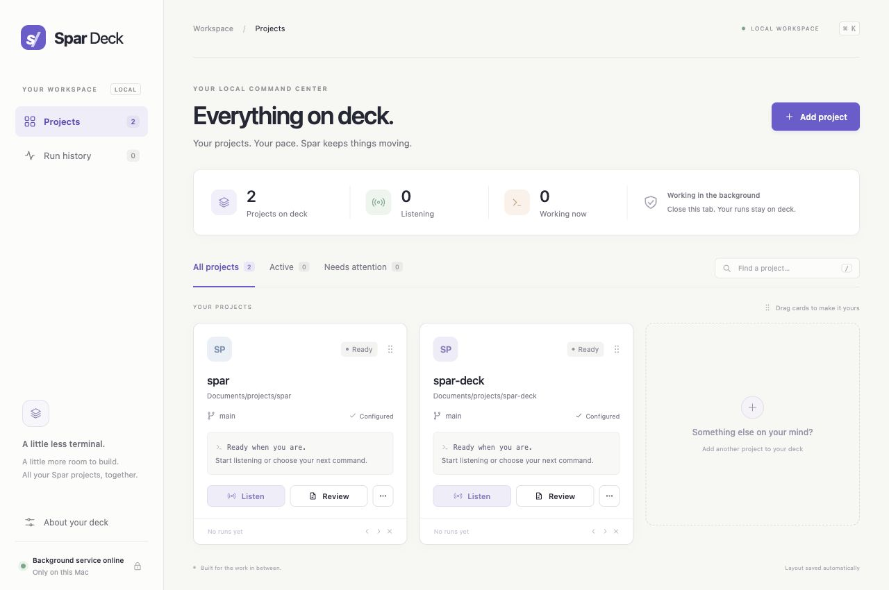
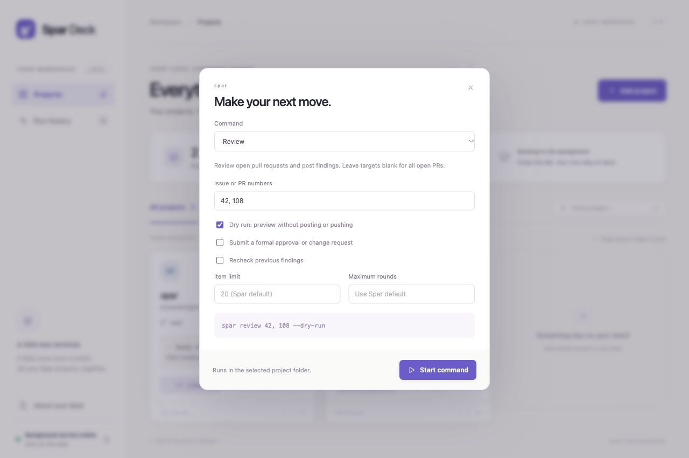

# Spar Deck

A calm, local command center for [Spar](https://github.com/coreyphillips/spar). Bring your repositories onto one deck, start commands with a click, and get your terminal tabs back.

## Screenshots

Keep project cards together, arrange them your way, and start Spar commands from one dashboard.



Choose specific pull requests, preview a dry run, and adjust review options before starting a command.



*Screenshots use example projects.*

## What it does

- Browse repositories under Documents, including nested project folders.
- Add project cards, drag them into your preferred order, or use keyboard-accessible move buttons.
- Start Listen and Review directly from a card.
- Edit each project's `spar.toml` with syntax checks and protection against stale saves.
- Turn a feature request, bug report, or enhancement into an issue and PR with Code.
- Run check-in, triage, resume, brainstorm, follow-up, split, doctor, initialize, and clean with structured command options.
- Choose issue or PR numbers, dry runs, limits, a lowest issue number, the base branch, the first agent, extra instructions, Resume's next reviewer, and other supported command flags.
- Read live output and previous runs, including exit status and timestamps.
- Keep runs alive when you close the browser or restart the dashboard server.
- Save cards, layout, run history, and recent logs on your own computer.
- Start the dashboard automatically at login with the included macOS service.

The server uses one small TOML parser dependency. There are no external fonts, analytics, or hosted services. Spar itself continues to use the tools and GitHub authentication already configured on your machine.

## Requirements

- macOS for the login-service installer. The server and process supervisor also work on Linux.
- Node.js 22 or newer, Git, and Spar on your PATH.
- Spar 0.4.25 or newer for the Code command. Upgrade Spar after that release is published.
- Spar's normal prerequisites, including GitHub CLI authentication and the tools selected in each project's `spar.toml`.

## Start

```sh
git clone https://github.com/coreyphillips/spar-deck.git
cd spar-deck
npm ci
npm start
```

Open **http://127.0.0.1:4177**. No build step is needed. Run `npm ci` after pulling updates to install the locked dependencies.

Choose **Add project**, browse to a Git repository, and add it. A repository without `spar.toml` gets an **Initialize** button. Initialization preserves existing configuration.

**Listen** runs `spar listen`. **Review** runs `spar review`, which reviews open PRs and posts findings. Use the three-dot command button for specific targets or a dry run. Commands run in the chosen repository and honor its existing Spar configuration.

Only one command can run per project at a time. Stop a listener before starting a manual review on the same project. Different projects can run simultaneously. This prevents commands from competing over Spar's shared state and worktrees.

## Start work from a prompt

Open a project's three-dot command button and choose **Code**. Describe the
feature, bug, or enhancement in **Project prompt**, including expected behavior
and any constraints. The field accepts multiple lines and up to 4,000 characters.

By default, Code runs `spar code` in that project. Spar reads the repository,
drafts and files one detailed GitHub issue, and passes it through the normal
triage, implementation, and PR review workflow. Existing project settings apply,
including its merge policy. Both reviewers still have to agree the work is worth
doing.

- **Dry run** drafts and displays the issue without filing or implementing it.
- **File issues without implementing** files the issue and stops.
- **Maximum rounds** overrides the run's review budget when supplied.

Dry run and file only are mutually exclusive. The command preview shows what
will run, and live output opens automatically after starting Code so you can
read the draft, issue URL, and progress. Prompts are passed as a single argument,
including newlines and shell punctuation. A prompt starting with a dash stays
request text rather than becoming a command option.

Stop any active command for the project before starting Code. If a run stops
after filing, use **Run** with the issue number printed in the output to continue.
Starting Code again files a new issue. Prompts are stored in the local run history
and job request files alongside the command's other arguments.

Code requires Spar 0.4.25 or newer. After the release is published, upgrade with
`cargo install spar-cli --locked`. If you use `SPAR_BIN`, update that executable
instead. Restart the deck server after updating this checkout, then reload the
browser. Updating the server leaves active Spar commands running.

## Command options

The three-dot command button offers each command's options from `spar <command> --help`.
Every agent command accepts a base branch, the agent that implements first, and extra
instructions for this run. Run, Code, Follow up, and Resume can also keep worktrees and
absorb follow-up waves. Run, Code, and Follow up can retriage or close declined issues.
Check in, Split, and Brainstorm add their own options. Agent keys are the names under
`[agents]` in `spar.toml`, such as `claude` or `codex`.

Options that take a path, `--quiet`, `--auto-merge`, `--no-worktrees`, and destructive
clean or init options are not offered. Run Spar from a terminal for those.

When a PR's head moves after Spar saved its review state, Resume stops and asks for
`--next <agent>`. Choose **Resume**, enter the PR number, and enter the agent that
should review the new head in **Next reviewer (agent)**. For example, `1923` and
`codex` run `spar resume 1923 --next codex`. Spar versions without this option
reject it with their own error.

## Edit a project's Spar configuration

Click **Edit config** on a project card to open that repository's `spar.toml`.
The editor shows the full file, including comments, so all Spar options remain
available. The project name and exact file path appear above the editor.

- **Save config** checks TOML syntax, then writes the edited text atomically.
  Comments, ordering, and existing file permissions are preserved. Files using
  CRLF line endings keep that convention. The editor supports UTF-8 files up to
  64 KB; larger files can still be edited in your usual text editor.
- **Update config** runs `spar init --update` in the selected project using your
  installed Spar version, then reloads the editor after a successful run. It appends
  missing options as comments with their defaults and descriptions, preserving
  existing settings. Upgrade Spar first to pick up newly released options. Save or
  reload unsaved edits before updating, and stop any active command for the project.
  The file must already exist; use Initialize first if needed. Update progress and
  failures appear in the editor, with **View update output** for the command log.
  Updates also appear in run history and continue if you close the editor.
- **Reload from disk** reads changes made by another editor. If the file changed
  since you opened it, saving is rejected and your draft stays in the editor.
  Copy your draft before reloading if you need to combine both versions.
- Closing or reloading an editor with unsaved changes asks before discarding them.
  Changes are not autosaved. Browser reloads warn before leaving an unsaved draft.
- You may inspect or draft changes while a command is active, but saving requires
  stopping that project's Deck command first. Updating requires the same. Use **Stop run** inside the editor
  to keep your draft while it stops. Start the command again to use the saved settings.
  Stop any Spar command launched outside Deck yourself before changing its config.

For a project without the file, **Add config** opens an empty editor where you can
paste an existing configuration. Alternatively, **Initialize** generates one using
Spar. New files are readable and writable only by your account. The editor refuses
symlinks and special files and writes only `spar.toml` in the selected project root.
It never commits or pushes configuration changes.

Syntax validation uses [smol-toml](https://github.com/squirrelchat/smol-toml), which
accepts TOML 1.1. It does not check Spar's schema, option compatibility with your
installed version, tool availability, or authentication. After saving, choose
**Doctor** in that project's command options for those checks. The Update option
is also available under **Initialize** in command options. Saving does not
start a Spar command or change the dashboard's own environment settings.

To update an existing installation, pull the latest code, run `npm ci`, restart
the server, and reload the browser. For the macOS login service, use
`npm run service:install` from its permanent checkout to restart it. Existing
Spar runs continue through the server restart.

## Run in the background on macOS

Run this from the permanent checkout location:

```sh
npm run service:install
npm run service:status
```

The installer registers `local.spar-deck` as a LaunchAgent, starts it, and captures the current PATH so tools installed through Homebrew, Cargo, or a Node version manager remain available outside a terminal. It uses the current Node executable. Reinstall the service after moving the checkout or removing that Node version.

The service keeps the web server available while you are signed in and starts it again at login. You can close the browser and terminal. Bookmark the dashboard to return later.

To remove the login service:

```sh
npm run service:uninstall
```

Removal preserves your saved data and any active Spar runs. Stop your runs in the dashboard first if you want them ended too.

### What survives

| Event | Saved layout and history | Active commands |
| --- | --- | --- |
| Close or reload the browser | Preserved | Continue |
| Stop or restart the web server | Preserved | Continue independently |
| Computer sleeps | Preserved | Paused by the OS until wake |
| Log out or reboot | Preserved | End; restart manually after login |

Commands are deliberately not replayed automatically after a reboot, since some can post comments, push code, or file issues. A lost supervisor is reported as interrupted. If its Spar process is still alive, the card needs attention and blocks another run until that process is stopped.

**Stop run** asks Spar to exit with SIGINT and allows up to 20 seconds for cleanup before forcing termination. Spar can create tool subprocesses in separate process groups, so the supervisor tracks descendants and checks their process identities before terminating them. A command stopped during a write should be inspected before retrying, as with Ctrl-C in a terminal. Unrelated Spar processes started outside the dashboard are not managed by the deck.

## Configuration

Set environment variables before starting or installing the service:

| Variable | Default | Purpose |
| --- | --- | --- |
| `SPAR_DECK_PORT` | `4177` | Loopback HTTP port |
| `SPAR_DECK_ROOT` | `~/Documents` | Folder the project picker can access |
| `SPAR_DECK_DATA` | `~/Library/Application Support/Spar Deck` | Persistent dashboard data |
| `SPAR_BIN` | `spar` | Spar executable path |

```sh
SPAR_DECK_ROOT="$HOME/projects" SPAR_DECK_PORT=4180 npm start
```

Use only one web server per data directory. For separate instances, choose separate data directories and ports.

The dashboard binds only to `127.0.0.1`. Host and origin validation, same-origin request tokens, and a restrictive content security policy prevent ordinary remote pages from controlling it. Commands are selected from an allowlist and executed as argument arrays without a shell. Project paths are canonicalized and confined to the configured root. This is a tool for a trusted local desktop account, not a shared or remotely hosted service. Do not expose it through a reverse proxy or tunnel.

## Saved data and logs

- `deck.json`: card order, project metadata, and run records.
- `jobs/<id>/request.json`: the exact command and working directory.
- `jobs/<id>/status.json`: process status, heartbeat, exit code, and timestamps.
- `jobs/<id>/output.log`: current output, rotated at 2 MB with one previous segment retained.
- `service.log` and `service-error.log`: web-service startup diagnostics.

The output viewer displays the most recent 64 KB. Run history is retained until you remove it from the data folder while the service is stopped. Removing a card never deletes its project files or saved run history. Data files are local to your account and are not included in this repository.

To back up your layout, copy the data directory while the web service and runs are stopped. A malformed data file is reported rather than silently replaced.

## Process-monitoring warnings

A message beginning with `[deck]` comes from the dashboard supervisor. `Could not inspect descendants: spawnSync /bin/ps ETIMEDOUT` in an older run means the operating system process scan exceeded its timeout; it does not mean the Spar command failed.

Process scans run asynchronously so a slow scan does not block output, heartbeats, or stop requests. Failed scans back off up to one minute. Brief outages are retried silently; a warning is logged only when scans keep failing for at least one minute. Warnings are limited to once every five minutes, including across recoveries, and recovery is logged only for an outage that produced a warning. Stop requests still verify process identities before signaling tool subprocesses. If cleanup cannot be verified, the run reports a failure for inspection.

Supervisor updates apply to newly started commands. Existing commands keep their original supervisor until they exit. Stop and restart a listener from its card when convenient to apply an update; restarting only the web service leaves existing supervisors unchanged.

## Development and verification

```sh
npm ci
npm test
```

The test suite uses disposable Git repositories and a fake Spar executable. It verifies path confinement, argument validation, host/origin protection, card ordering, configuration syntax and stale-save protection, safe configuration file handling, run persistence through a web-server restart, duplicate-run prevention, exit reporting, and termination of subprocesses in their own process groups. It does not run reviews or modify remote repositories.

The interface is plain HTML, CSS, and JavaScript in `public/`. The HTTP server and independent run supervisor are in `src/`. Changes to static assets require a browser reload; server changes require a restart.

## License

MIT
